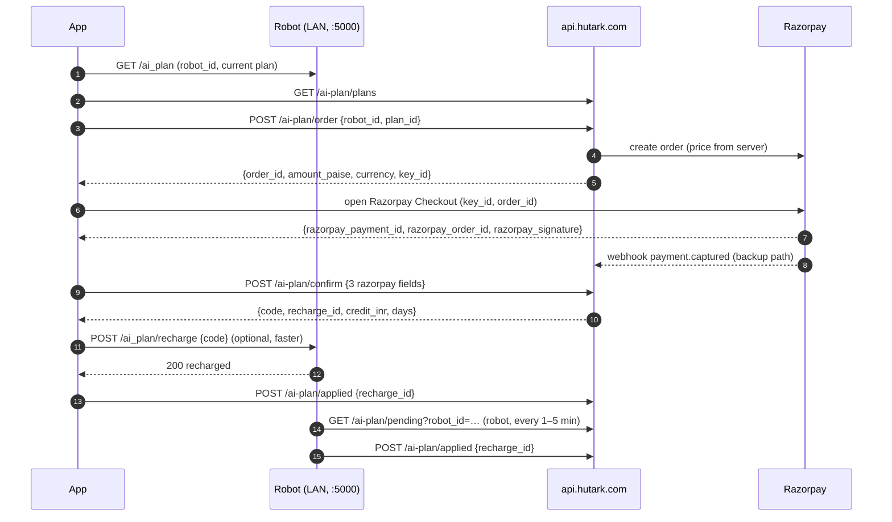

# Hutark Robot Payment – AI plan API

Customers pay monthly (Razorpay) for their robot's ChatGPT usage. This repo
contains the **payment server** and this **integration guide for the Hutark
app**.

- The customer pays on Hutark's **payment page**
  `https://api.hutark.com/recharge?robot=<robot_id>` (any phone or computer,
  anywhere, no app needed) **or in the Hutark app**.
- The server takes the Razorpay payment, verifies it, and issues a **recharge
  code** (`HTK1.…`) signed with Hutark's private key.
- **The robot fetches its own code** from the server (every minute while it
  has no plan, every 5 minutes otherwise), checks the signature with Hutark's
  public key and turns on ChatGPT. The app may also hand the code over
  directly on the local network – that is just faster, not required.

Production base URL: **`https://api.hutark.com`**
(currently running with Razorpay **test** keys)

> **Simplest app integration:** open
> `https://api.hutark.com/recharge?robot=<robot_id>` in the browser / a
> WebView and you are done. Sections 2–7 are only needed if the app wants
> its own native checkout.

---

## Contents

1. [How it works](#1-how-it-works)
2. [App integration step by step](#2-app-integration-step-by-step)
3. [Server API reference](#3-server-api-reference)
4. [Robot API reference (local network)](#4-robot-api-reference-local-network)
5. [Error handling cheat-sheet](#5-error-handling-cheat-sheet)
6. [Rules for the app](#6-rules-for-the-app)
7. [Testing with Razorpay test mode](#7-testing-with-razorpay-test-mode)
8. [Repository layout & running the server locally](#8-repository-layout--running-the-server-locally)

---

## 1. How it works



The payment page (`/recharge`) runs the same order → Checkout → confirm
steps in the browser and then shows "robot recharged" once the robot has
fetched and applied the code.

Important properties:

- **One payment = one code.** `/confirm` can be retried safely – it always
  returns the same code for the same payment.
- **Nothing is lost if the app or browser dies after paying.** Razorpay's
  webhook also makes the server issue the code, and the robot fetches it by
  itself.
- **A code works on one robot only, once.** It cannot be used on another robot.
- **Two payments both count.** If the robot still has credit when a new code
  arrives, the unused credit is added to the new 30-day plan.
- **The price is decided by the server**, never by the app.

---

## 2. App integration step by step

### Step 0 – know which robot
Call the robot (same Wi-Fi) `GET http://<robot-ip>:5000/ai_plan`. Use its
`robot_id` for everything below, and show the current plan (`active`,
`remaining_inr`, `days_left`, …).

### Step 1 – show the price
`GET https://api.hutark.com/ai-plan/plans` →
`[{"plan_id":"monthly","price_inr":499,"credit_inr":300,"days":30}]`

Show `price_inr` (what the customer pays) and that the robot gets
`credit_inr` of ChatGPT usage for `days` days.

> A new recharge starts a fresh 30-day plan; credit left on the current plan
> is added to it, so recharging early loses nothing.

### Step 2 – create the order
```http
POST https://api.hutark.com/ai-plan/order
Content-Type: application/json

{"robot_id": "GIYA001", "plan_id": "monthly"}
```
```json
{"order_id": "order_XXXX", "amount_paise": 49900, "currency": "INR",
 "key_id": "rzp_test_XXXX", "robot_id": "GIYA001", "plan_id": "monthly"}
```

### Step 3 – Razorpay Checkout
Open Razorpay Checkout with the official SDK for your platform
(Android / iOS / Flutter / React Native / Web) using **exactly** these values
from step 2:

| Checkout option | Value |
|---|---|
| `key` | `key_id` (do **not** hard-code it – test/live is decided by the server) |
| `order_id` | `order_id` |
| `amount` | `amount_paise` |
| `currency` | `currency` |
| `name` / `description` | e.g. "Hutark" / "AI plan – monthly" |

On success Checkout gives you `razorpay_payment_id`, `razorpay_order_id`,
`razorpay_signature`. On failure/cancel: show the error, nothing else to do.

### Step 4 – get the code
```http
POST https://api.hutark.com/ai-plan/confirm
Content-Type: application/json

{"razorpay_order_id": "order_XXXX",
 "razorpay_payment_id": "pay_XXXX",
 "razorpay_signature": "<hex from Checkout>"}
```
```json
{"code": "HTK1.eyJ2Ijox....", "recharge_id": "pay_XXXX",
 "robot_id": "GIYA001", "credit_inr": 300, "days": 30}
```
Retry on network errors / 5xx (with back-off). Same payment → same code.
Store `code` + `recharge_id` locally until step 6 succeeds.

### Step 5 – apply the code on the robot
```http
POST http://<robot-ip>:5000/ai_plan/recharge
Content-Type: application/json

{"code": "HTK1.eyJ2Ijox...."}
```
200 → recharged (the robot also says "Thank you. My AI plan is recharged.").
400 → see `message` in [section 5](#5-error-handling-cheat-sheet).

This step is optional: the robot also fetches the code from the server by
itself within a few minutes (when it is on and online). Do it when the phone
is on the **same network as the robot** – the recharge is then instant. If the
robot is not reachable, just tell the user "your robot will recharge itself
shortly". You can poll `GET /ai-plan/recharge-status?recharge_id=…` to show
when it happened.

### Step 6 – tell the server it was applied
```http
POST https://api.hutark.com/ai-plan/applied
Content-Type: application/json

{"recharge_id": "pay_XXXX"}
```
Also do this when the robot answers `code_already_used` (it was applied
before). Calling it twice is fine.

### Step 7 – (optional) recover unapplied codes on app start / robot connect
The robot does this by itself; do it in the app only for an instant recharge.
```http
GET https://api.hutark.com/ai-plan/pending?robot_id=GIYA001
```
```json
[{"recharge_id": "pay_XXXX", "code": "HTK1....", "credit_inr": 300,
  "days": 30, "created": 1764000000.0}]
```
For each entry (oldest first): do step 5, then step 6.
This covers: app killed after payment, phone not near the robot, network
errors after `/confirm`.

> Codes must be applied **within 7 days** of `created`, otherwise the robot
> answers `code_too_old` – contact Hutark support (a new code can be issued).

---

## 3. Server API reference

Base URL `https://api.hutark.com`. JSON in and out. Errors are always
`{"error": "<text>"}`. Max request body 64 KB (413).

| Method & path | Body / query | Success | Errors |
|---|---|---|---|
| `GET /health` | – | `{"ok": true}` | – |
| `GET /ai-plan/plans` | – | `[{plan_id, price_inr, credit_inr, days}]` | – |
| `POST /ai-plan/order` | `{robot_id, plan_id}` | `{order_id, amount_paise, currency, key_id, robot_id, plan_id}` | 400 bad input, 429, 502 payment provider unavailable |
| `POST /ai-plan/confirm` | `{razorpay_order_id, razorpay_payment_id, razorpay_signature}` | `{code, recharge_id, robot_id, credit_inr, days}` | 400 not verified / unknown order, 409 order already paid by another payment, 429 |
| `GET /ai-plan/pending` | `?robot_id=X` | `[{recharge_id, code, credit_inr, days, created}]` | 400 missing robot_id, 429 |
| `POST /ai-plan/applied` | `{recharge_id}` | `{ok: true, recharge_id, applied: true}` | 400 missing, 404 unknown recharge_id, 429 |
| `GET /ai-plan/robot` | `?robot_id=X` | `{robot_id, model}` (model may be null) | 400, 404 not a Hutark robot, 429 |
| `GET /ai-plan/recharge-status` | `?recharge_id=pay_X` | `{recharge_id, robot_id, applied, applied_at}` (never the code) | 400, 404, 429 |
| `GET /recharge` | `?robot=X` (optional) | customer payment web page | – |
| `POST /ai-plan/webhook` | Razorpay only (signed) | – | not for the app |

When the server has a factory robot list (see
[`server/README_SERVER.md`](server/README_SERVER.md)), `/order` answers
**404 `unknown robot_id`** for robots that are not on it.

- `robot_id`: 1–64 characters `A-Z a-z 0-9 _ -`.
- `created`: Unix time (seconds, UTC).
- Rate limits per client IP: order 20/min, confirm 40/min, pending+applied
  120/min. On **429** wait for the `Retry-After` seconds (60).
- Timeouts: use ~30 s for `/order` and `/confirm` (they may call Razorpay).

---

## 4. Robot API reference (local network)

The robot serves HTTP on port **5000** on the local network.

### `GET /ai_plan`
```json
{"status": "ok", "robot_id": "GIYA001", "active": true, "reason": "ok",
 "credit_inr": 300.0, "used_inr": 12.4, "remaining_inr": 287.6,
 "remaining_pct": 95.9, "days_left": 27.5, "valid_until": 1766600000,
 "low": false}
```
`reason`: `ok` · `no_plan` · `expired` · `credit_used_up`.
`low` = true when the credit or the days are nearly used up → good moment to
suggest a recharge.

### `POST /ai_plan/recharge {"code": "HTK1...."}`
200 with the new plan status (as above) and `"status": "ok"`, or 400 with
`"status": "error"` and a `message` (see below).

### `POST /ai_plan/sync`
Makes the robot check the server for paid recharges **now** instead of at
its next background check. `200 {"ok": true, "applied": n, "pending": n,
"plan": {…}}`, or `502 {"ok": false, "error": "…"}` when the robot cannot
reach the server.

### `GET /status`
The robot's general status also contains `ai_plan_active`, `ai_plan_reason`,
`ai_credit_remaining_inr`, `ai_credit_remaining_pct`, `ai_plan_days_left`,
`ai_plan_low`.

---

## 5. Error handling cheat-sheet

Robot `POST /ai_plan/recharge` → `message`:

| message | Meaning | What the app does |
|---|---|---|
| *(200)* | recharged | `POST /ai-plan/applied`, show success |
| `code_already_used` | this code was applied earlier | `POST /ai-plan/applied`, refresh `GET /ai_plan` |
| `code_too_old` | code older than 7 days | contact support |
| `code_is_for_another_robot` | wrong robot | find the right robot (`robot_id`) |
| `robot_clock_wrong` | robot's clock is off | ask user to connect the robot to the internet, retry |
| `invalid_code` / `invalid_signature` | damaged or fake code | re-fetch via `/pending`; if it persists, support |
| `robot_has_no_identity` / `robot_not_configured_no_public_key` | robot setup problem | support |
| robot unreachable | phone not on robot's network / robot off | keep code, retry later (step 7) |

Server:

| Situation | What the app does |
|---|---|
| network error / 5xx / 502 | retry with back-off (all calls are safe to retry) |
| `/confirm` 400 "payment could not be verified" | do **not** retry; show error; the code will still appear in `/pending` if Razorpay captured the payment |
| 409 | contact support (order already paid with another payment) |
| 429 | wait `Retry-After` seconds |

---

## 6. Rules for the app

- **Never** put any Razorpay secret in the app. The app only gets `key_id`
  from `/order`.
- Don't send the price; the server decides it. Display `price_inr` from
  `/plans`.
- Don't hard-code `key_id` – it switches from test to live on the server.
- Treat codes like vouchers: don't log them or send them to analytics.
- If the app delivers codes itself, finish with `/applied`. The `/pending`
  recovery is optional – the robot fetches unapplied codes by itself.

---

## 7. Testing with Razorpay test mode

The server currently uses **Razorpay test keys**, so no real money moves.

- In Checkout use UPI ID **`success@razorpay`**, **Netbanking** (any bank →
  click *Success* on the test page) or a card from Razorpay's
  [Test Card Details](https://razorpay.com/docs/payments/payments/test-card-details/)
  (any future expiry, any CVV).
- Use a test robot id (e.g. `TEST001`) if you don't have a robot; steps 1–4,
  6 and 7 work without one. A real robot rejects codes for other robots.
- When the server switches to live keys, `key_id` from `/order` becomes
  `rzp_live_…` automatically – no app change needed.

---

## 8. Repository layout & running the server locally

```
server/
  recharge_api.py     Flask API (all endpoints above)
  ai_recharge.py      key generation + signing/checking of HTK1 codes
  web/                customer payment page (/recharge): html, js, css
  requirements.txt
  tests/              pytest suite (Razorpay mocked, no network)
  README_SERVER.md    server notes (pricing, manual codes)
```

Run the tests:

```bash
cd server
pip install -r requirements.txt pytest
python -m pytest tests
```

Run locally with **your own Razorpay test keys** and a throwaway key pair
(never use the production key):

```bash
cd server
export HUTARK_AI_PRIVATE_KEY=$PWD/dev_private.key AI_PLAN_DB=$PWD/dev.db
export RAZORPAY_KEY_ID=rzp_test_xxx RAZORPAY_KEY_SECRET=xxx RAZORPAY_WEBHOOK_SECRET=any-dev-secret
python ai_recharge.py keygen
python recharge_api.py            # http://127.0.0.1:8080
```

Never commit keys, `.env` files or databases (see `.gitignore`).

Questions / support: Hutark (Arjun).
